<h1 align="center">PI dreams</h1>

<p align="center"><a href="README.md">Português</a> · <b>English</b></p>

<p align="center">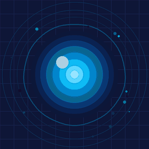</p>

<p align="center">
  <b>A free, local voice assistant for Windows, in the style of sci-fi AI assistants.</b><br>
  It talks in Brazilian Portuguese, sees through your webcam when you ask and remembers what you
  told it. The AI runs on your own computer: your voice, your image and your conversations never
  go to the cloud.
</p>

<p align="center">
  <a href="https://github.com/Pedro-Bianco/3-14-DREAMS/actions/workflows/tests.yml"></a>
</p>

<p align="center">
  <a href="../../releases/latest"></a>
</p>

> The assistant speaks and understands **Brazilian Portuguese only**. Its interface is in Portuguese too.

## Features

- **Voice and text chat**, with barge-in (you can talk over it), six voices to choose from and an
  optional assistant voice effect. Answers [stream](#from-the-end-of-your-speech-to-the-answer): it speaks
  the first sentence while still writing the rest.
- **Four [appearances](#appearances)**, drawn by the app itself and switched live: a 3D holographic
  face that follows the mouse pointer with its eyes and moves its mouth with the speech, an energy
  core, a 3D holographic digital brain and an orb. All of them show listening, thinking and
  speaking, and react to the voice volume without using the GPU.
- **A window that adapts** from a laptop to an ultrawide monitor: the appearance grows with the
  space, the spoken sentence shows as a caption and, on wide screens, cards show the weather,
  today's calendar, reminders and unread e-mail.
- **Camera on demand**: "can you see me?", "what am I holding?".
- **[Long-term memory](#memory-and-document-base)**: remembers what you tell it (name,
  preferences, work, family) and uses it in any request, understands short answers like "yes, since
  2019" and forgets what is no longer true ("I sold the car").
- **[Document base](#memory-and-document-base)**: store PDF, Word, spreadsheets, slides and text;
  it answers from them, finding by meaning or by the exact word (codes, order numbers), and says
  which file and page it came from.
- **[Memory map](#memory-map)**: under the assistant, everything it stored shows as a graph grouped
  by topic (family, work, hobbies...), together with the documents; what it used in the last answer
  is highlighted, so you can see why it answered that way.
- **[Deep research](#deep-research)**: clears up the topic with multiple-choice questions,
  researches it on Wikipedia and in the news, reads the sources and writes a report with
  citations, stored in the document base.
- **[Monitoring](#monitoring)**: a 3D globe you spin with the mouse, with the 16,000+ satellites in
  orbit in real time, today's earthquakes, radios from around the world and live aircraft with trails. Click a country or ask
  ("what is happening in Japan?") and a dedicated agent sums up the news there citing the outlets,
  plus weather, flights and live radio. Uses the internet, with free sources; the rest stays local.
- **Tools**: opens apps, searches the web, reads pages and uses the clipboard.
- **PC control**: volume, mute and media (pause, next, previous), open windows (list, bring to
  front, minimize, maximize, close), screen brightness, lock, shut down and restart. Closing,
  locking, shutting down and restarting only happen after your "yes".
- **Daily briefing** when it opens (date, weather, today's events, unread e-mail, reminders) and
  **reminders** by voice.
- **Connections via [MCP](https://modelcontextprotocol.io/)**, each off until you turn it on:
  files (only in folders you allow), a separate Edge browser, Gmail, Google Calendar (read-only)
  and any local MCP server. Anything that **changes** something waits for your "yes".

## Appearances

All drawn by the app itself, with no GPU and no third-party art, and switched live in Configurações →
Geral. Each one shows the same states: idle, listening, thinking and speaking (following the rhythm
and volume of the voice).

| Appearance | What it looks like |
|---|---|
| **Face** | A 3D hologram of points and lines built on MediaPipe's open face geometry (Apache-2.0). Turns its head and eyes towards the mouse pointer, blinks and moves its mouth and jaw on every syllable |
| **Energy core** | A blue, sci-fi style energy ring with spinning arcs that pulses with the voice |
| **Digital brain** | A 3D hologram with two hemispheres, folds, cerebellum and brainstem, generated by code, slowly drifting on its own. Thinking, light pulses run along its links; speaking, waves of light leave the centre with the voice |
| **Orb** | A minimal sphere of light with a wave around it that follows the real voice volume |

<table>
  <tr>
    <td align="center">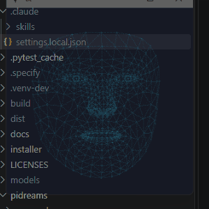<br><b>Face</b></td>
    <td align="center"><br><b>Energy core</b></td>
    <td align="center">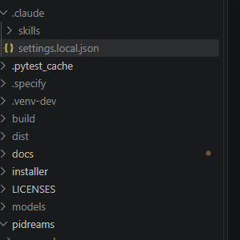<br><b>Digital brain</b></td>
    <td align="center"><br><b>Orb</b></td>
  </tr>
</table>

## Memory and document base

PI has two memories, both kept only on your PC:

**Long-term memory: what you told it.** Every 4 messages, or right away when you say something
about yourself ("I work with...", "I moved to..."), it rereads the recent conversation and writes down
the new facts as short sentences. Your name, what to call you and how you like it to answer go to the
**profile**, which is always present; the rest become **facts**, looked up by meaning on every
question (the 3 closest). Before storing, it compares with similar memories and decides whether the
fact is new, already known, replaces an old one ("I work somewhere else now") or deletes one that is no
longer true ("I sold the car"); when in doubt, it keeps rather than deletes. The full list is in the
**Memória** tab, where you can delete one by one or everything; its **Como funciona** button shows
this whole flow as a diagram, from what is stored to what is recalled.

<p align="center">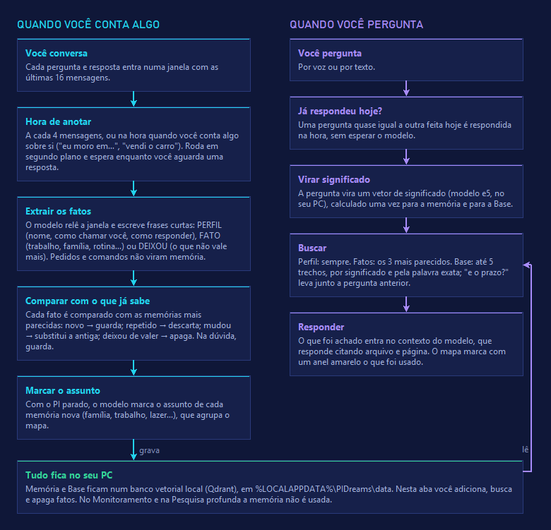<br><sub>The <b>Como funciona</b> window of the Memória tab (the app is in Portuguese). Left: storing, from the conversation to comparing with what it already knows. Right: recalling, from the question to the answer.</sub></p>

**Document base: what you handed it.** In the **Base** tab, pick files (PDF, Word, PowerPoint, Excel,
CSV, TXT, Markdown) or paste a text with a title. Each file is split into pieces that remember where
they came from (PDF page, slide, spreadsheet sheet). On every question it searches the pieces two
ways at once, by **meaning** ("late fee" finds "penalty for delay") and by the **exact word** (it tells
contract "2024-0815" from "2024-0816"), and answers naming the file and the place ("p. 3", "slide 5").
Deep-research reports go here too. In the tab, each document opens to show its pieces.

A question almost identical to one asked earlier the same day is answered at once, without waiting
for the model.

## Memory map

Under the appearance, the **Mapa da memória** draws everything PI knows as a graph:

<p align="center">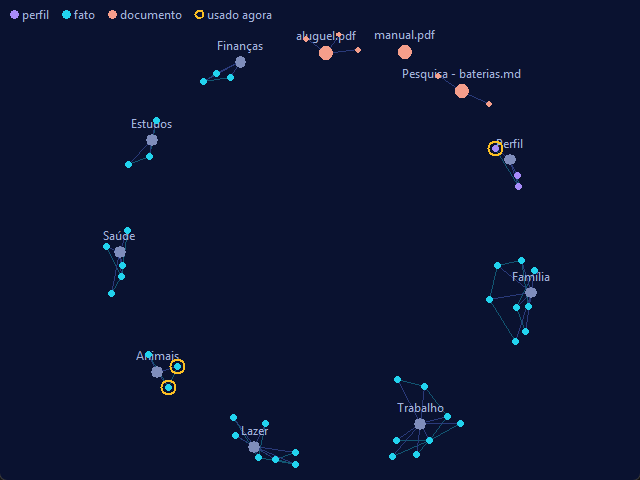<br><sub>Fictitious memories and documents.</sub></p>

- **topics** (family, work, health, routine, hobbies, pets, home, finances, studies) at the centre of
  each group. The model itself tags each memory's topic, a few at a time and only while idle;
- **profile** in violet, **facts** in cyan, each linked to the most similar one of the same topic;
- **documents** from the base in peach, with their pieces when the document is opened;
- a **yellow ring** around what it used in the last answer (memories and pieces), so you can see why
  it answered that way.

Drag to move, use the wheel to zoom and click a point to read the full text or delete that memory.
**Minimizar** folds the map away; it costs nothing while hidden.

## Monitoring

<p align="center"></p>

The **Monitoramento** button (or "abra o monitoramento" by voice) swaps the appearance for a dotted
globe that spins with the mouse and zooms with the wheel. Around it, the **16,000+ active
satellites** move in real time at their altitude, with the ISS highlighted. Today's earthquakes show
as circles sized by magnitude and radios around the world as violet dots. **Aircraft** show up live
when you zoom into a region (see [below](#live-aircraft)).

While it is open, a **dedicated agent** takes over the conversation with monitoring functions
only. Click a country or ask about a place and the globe turns there while it answers:

<table>
  <tr>
    <td align="center">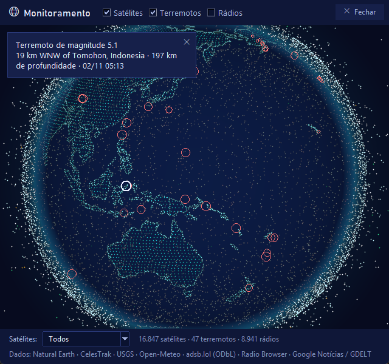<br><b>Today's earthquakes</b><br>click for place, magnitude and time</td>
    <td align="center">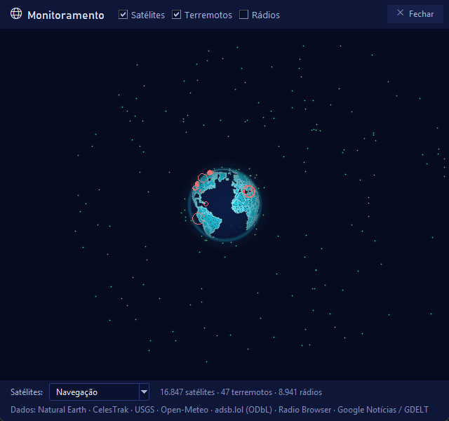<br><b>Satellite filter</b><br>here, navigation only (GPS, Galileo, GLONASS)</td>
    <td align="center">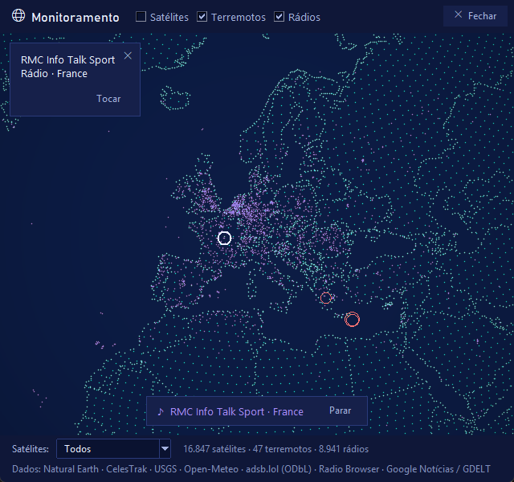<br><b>Live radio</b><br>plays inside PI and pauses while it speaks</td>
  </tr>
</table>

### Live aircraft

<p align="center">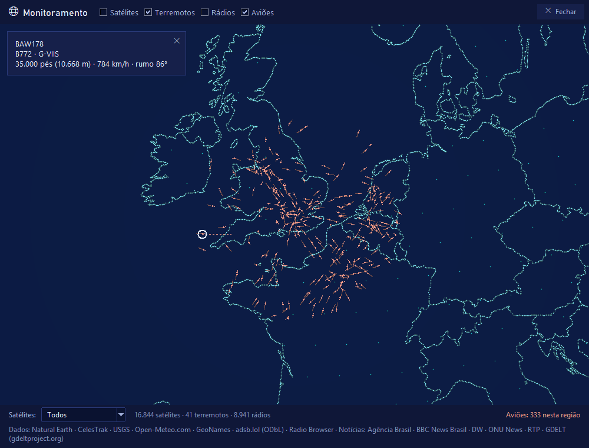</p>

Turn on **Aviões** in the Monitoring bar and zoom in over a region (or say "mostra os aviões sobre
Londres", or ask for a flight by number, "onde está o voo GLO1808?"): the aircraft flying within ~460 km show up, refreshed every ~10 s and moving smoothly in
between by their speed and heading. Each one leaves a **trail** of the path it flew since you started
watching. Click a plane for flight, type, registration, altitude and speed, plus a line of its heading
for the next 10 minutes. Zoomed in, coastlines and borders are drawn in detail. Data from
[adsb.lol](https://adsb.lol) (ODbL); PI only queries it with the layer on and a region on screen, and
shows a notice if the source does not answer.

Ask (in Portuguese) for the news of a place, the weather, today's earthquakes, flights overhead (or to
show them live), a local radio or where the ISS is; it sums up the news citing the outlets. Sources, all free and
keyless: the news feeds the outlets publish (Agência Brasil, BBC News Brasil, DW Brasil, ONU News, RTP), [Open-Meteo](https://open-meteo.com),
[USGS](https://earthquake.usgs.gov), [adsb.lol](https://adsb.lol) (ODbL),
[CelesTrak](https://celestrak.org) orbits (positions computed on your PC),
[Radio Browser](https://www.radio-browser.info) and [Natural Earth](https://www.naturalearthdata.com)
outlines. It uses the internet only while open; saved orbits keep the satellites moving offline. No
cameras.

## Deep research

The **Pesquisa profunda** button (or "abra a pesquisa profunda" by voice) opens a mode where a dedicated
agent researches a topic: when the topic is vague it first asks 1–3 multiple-choice questions (you click,
answer by voice or skip), then splits it into 3–5 questions, searches Wikipedia (Portuguese and English)
and the news, reads up to 12 sources taking notes only of what answers the questions, and writes a
report with numbered citations of the sources it read (with the stronger research model, if you
downloaded it in Configurações → Hardware). It speaks a summary and stores the report in the
document base, so you can ask about it later. Takes 1–3 minutes, with progress; "cancelar pesquisa"
stops it. Free sources only, no account; very narrow topics may yield fewer sources.

<table>
  <tr>
    <td align="center">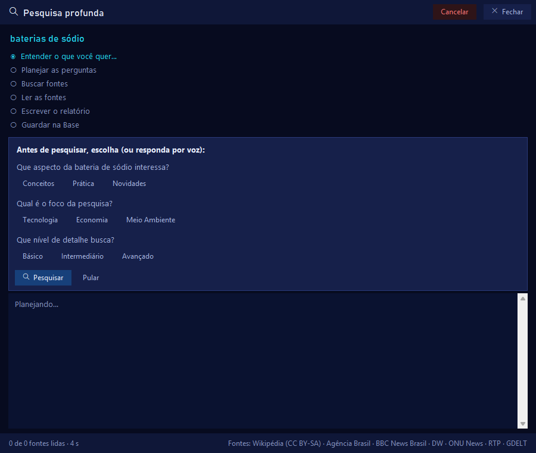<br><b>1. Understand the request</b><br>option questions: click, answer by voice or skip</td>
    <td align="center">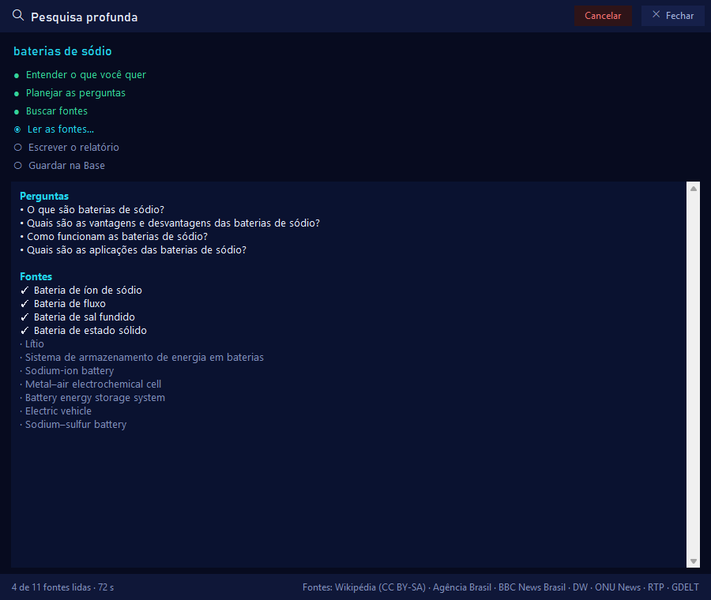<br><b>2. Plan and read</b><br>the plan's questions and each source ticked once read</td>
    <td align="center">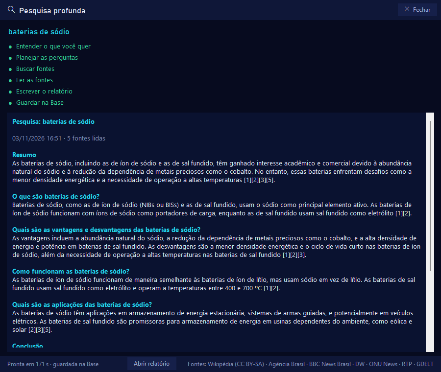<br><b>3. Report</b><br>one section per question, citations [1], [2]… and the file in the base</td>
  </tr>
</table>

<sub>A real research on "baterias de sódio" (sodium batteries), run by PI itself; the app is in Portuguese.</sub>

## Privacy

| Stays on your PC | Uses the internet, only when you ask or connect it |
|---|---|
| Your voice (audio is never written to disk) | Weather ([Open-Meteo](https://open-meteo.com)) |
| Conversations and the AI that answers | Web search (opens in your browser; PI checks Wikipedia and the news feeds) and reading the pages you ask for |
| Camera images | Gmail and Google Calendar, if connected |
| Memory, document base and reminders | The browser, on the sites you ask for |
| Settings and passwords (encrypted) | One-time downloads of models and Node |
| Deep-research reports (in the document base) | Deep research, when you ask: the topic goes to Wikipedia and, when the news feeds have nothing, to GDELT |
| The globe and the satellite position math | Monitoring, while open: the places you ask about or click go to the weather and flight sources; the news feeds, orbits, earthquakes and the radio list are downloaded; a playing radio connects straight to the station |

No account, no subscription, no telemetry.

## Requirements

Windows 10 or 11 (64-bit), 16 GB of RAM and 15 GB of free disk space. A GPU (NVIDIA, Intel Arc
or AMD) is optional but makes answers much faster. Internet is needed during installation to
download the AI models; after that, chat works offline.

## Install

Download `PIDreams-Setup-<version>.exe` from the [latest release](../../releases/latest) and run
it. The installer is not code-signed yet, so Windows SmartScreen may warn you: click **More info →
Run anyway**. It checks the requirements, installs [Ollama](https://ollama.com) if needed and
downloads the models. No administrator rights required.

## AI models

Downloaded during installation, each under its author's license. The chat model (via Ollama) is
picked from your hardware and can be changed in the settings:

| Your PC | Chat model |
|---|---|
| No dedicated GPU, or less than 6 GB | Qwen3 4B Instruct |
| GPU with 6 to 16 GB | Qwen3 8B |
| GPU with 16 GB or more | Qwen 2.5 14B |

Plus Whisper (speech recognition), `multilingual-e5-large` (memory and document base) and, the first
time you turn the camera on, Qwen3-VL 2B (vision). All chat and vision models are Apache-2.0.

The default voice, a formal baritone, runs on Kyutai's [Pocket TTS](https://github.com/kyutai-labs/pocket-tts)
(CC-BY-4.0 weights, ~210 MB). It was made for PI dreams from a text description with
[VoxCPM2](https://huggingface.co/openbmb/VoxCPM2), without recording anyone's voice. It runs without a GPU and
streams: the first sound comes about 0.2 s after a sentence starts, 3.8 times faster than real time.

Configurações → Áudio e voz also offers the [Kokoro](https://huggingface.co/hexgrad/Kokoro-82M) voices (Alex,
Santa, Dora, Onyx or an Alex + Santa blend; Apache-2.0, ~340 MB, downloaded the first time one is chosen)
and an optional assistant effect (light, medium or strong).

Deep research can write its report with a stronger model, Qwen 2.5 14B (~9 GB, optional, in
Configurações → Hardware). It is slower, but the research runs in the background; without it, the
chat model is used.

### From the end of your speech to the answer

PI dreams does not wait for the whole answer before it starts talking:

1. **End of speech**: 1.2 s of silence ends your turn.
2. **Transcription**: Whisper transcribes the whole sentence at once, on the CPU.
3. **Memory and documents**: related memories and document pieces are looked up.
4. **Streaming chat model**: the answer comes from Ollama piece by piece, and each sentence goes to the
   voice as soon as it is finished, while the model keeps writing the next ones.
5. **Streaming voice**: each sentence starts playing while it is still being generated, and the next one
   is prepared while the previous one plays, in one continuous audio stream with no gap between them.
   You can talk over it: PI dreams tells your voice apart from the echo of its own voice in the speakers.

The app logs how long each stage took on every turn. Measured in real conversations with Qwen3 8B on a
12 GB GPU (Intel Arc B580) and the default voice:

| Stage | Measured |
|---|---|
| Silence that ends your turn | 1.2 s |
| Transcription (Whisper small, CPU) | 1.2–1.6 s |
| Memory and document base | 0.1–0.3 s |
| First sentence from the chat model | 0.5–0.8 s in conversation; 2–3 s when it uses a tool (news, flights, search) |
| Voice until it plays | 0.11–0.20 s |
| **Total, from the end of the silence to hearing the answer** | **2.0–4.3 s** |

Before these optimizations the same PC took 8–12 s. What mattered most:

| Change | Before | After |
|---|---|---|
| Chat model on a 12 GB GPU | Qwen 2.5 14B spilled into system memory: 2.6 tokens/s | Qwen3 8B fully on the GPU: 44–58 tokens/s |
| Answer | waited for the whole text | streaming: speaks the 1st sentence while writing the rest |
| Document pieces in small talk | 5 pieces (+1,800 tokens), 1st sentence in 5–9 s | 2 pieces when the match is weak |
| Silence that ends the turn | 1.8 s | 1.2 s |
| Transcription | 4 cores: 1.56 s per sentence | one per physical core: ~1.35 s |
| Voice until it plays | 0.4–1.8 s (whole sentence generated first) | 0.11–0.20 s (streaming) |

Voice speed on the CPU: the default voice (Pocket TTS) generates speech 3.8 times faster than real time;
the Kokoro voices 5 times, but they only play once the whole sentence is ready.

## For developers

Requires [Python 3.12 from python.org](https://www.python.org/downloads/) and [Ollama](https://ollama.com).

```powershell
python -m venv .venv-dev
.venv-dev\Scripts\pip install -r requirements\build.txt
.venv-dev\Scripts\python -m pidreams
.venv-dev\Scripts\python -m pytest -q        # tests
```

`tests/unit` and `tests/smoke` run without network, GPU or models (fake sources, chat model and sound;
the few that need the downloaded models skip themselves) and run on every push in GitHub Actions. One
of them searches every tracked file for personal data and secrets. `tests/eval` holds the evaluations
with the real models and sources (tool choice, memory, monitoring, deep research), run by hand:
`python -m tests.eval.<name>`.

## Built with

[Ollama](https://ollama.com) and [Qwen](https://github.com/QwenLM) models,
[faster-whisper](https://github.com/SYSTRAN/faster-whisper), [pocket-tts](https://github.com/kyutai-labs/pocket-tts), [kokoro-onnx](https://github.com/thewh1teagle/kokoro-onnx), [VoxCPM2](https://github.com/OpenBMB/VoxCPM) (default voice design),
[Qdrant](https://qdrant.tech) and [FastEmbed](https://github.com/qdrant/fastembed),
[pypdf](https://github.com/py-pdf/pypdf), [sgp4](https://github.com/brandon-rhodes/python-sgp4), [miniaudio](https://github.com/irmen/pyminiaudio),
[Model Context Protocol](https://modelcontextprotocol.io/), [OpenCV](https://opencv.org) and
[LangChain Text Splitters](https://github.com/langchain-ai/langchain).

Monitoring data, fetched only while in use: [Natural Earth](https://www.naturalearthdata.com) (outlines, public domain), [CelesTrak](https://celestrak.org), [USGS](https://earthquake.usgs.gov), [Open-Meteo](https://open-meteo.com) (place names from [GeoNames](https://www.geonames.org)), [adsb.lol](https://adsb.lol) (ODbL), [Radio Browser](https://www.radio-browser.info), the news feeds of [Agência Brasil](https://agenciabrasil.ebc.com.br), [BBC News Brasil](https://www.bbc.com/portuguese), [DW Brasil](https://www.dw.com/pt-br), [ONU News](https://news.un.org/pt) and [RTP](https://www.rtp.pt/noticias). Deep research also uses [GDELT](https://www.gdeltproject.org).

## License

The PI dreams code is [MIT](LICENSE). The Windows installer bundles eSpeak NG and phonemizer (voice
pronunciation, GPL-3.0), so the
installer as a whole is distributed under the [GPL-3.0](LICENSES/GPL-3.0.txt). See
[THIRD_PARTY_NOTICES.md](THIRD_PARTY_NOTICES.md).
