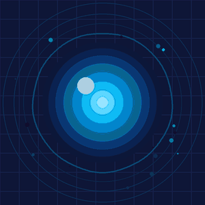
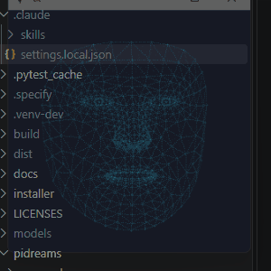
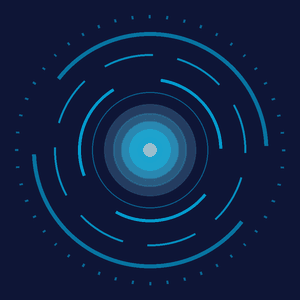
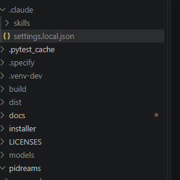
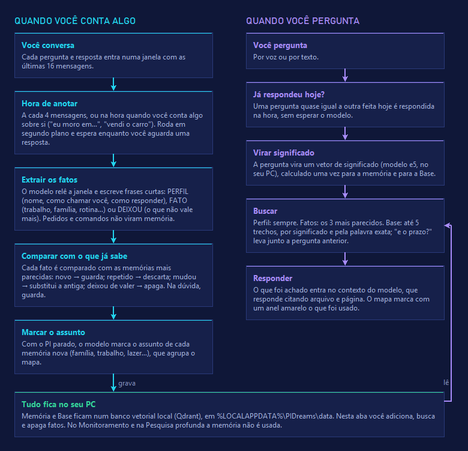
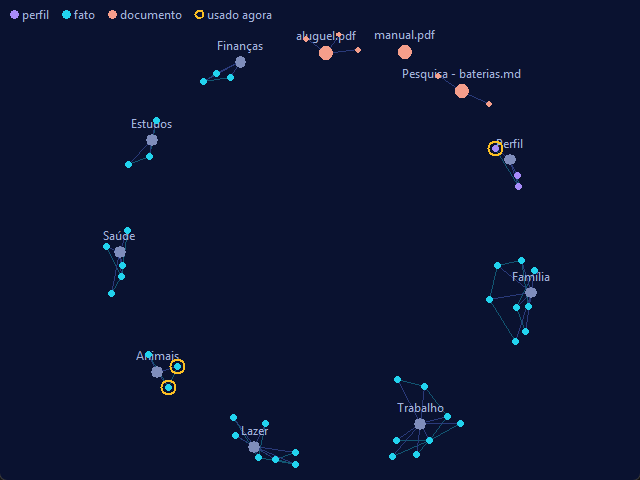
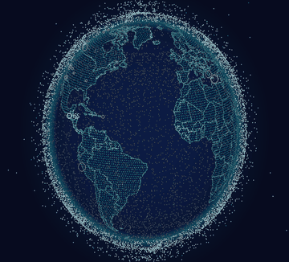
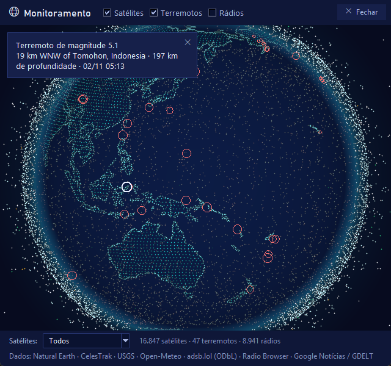
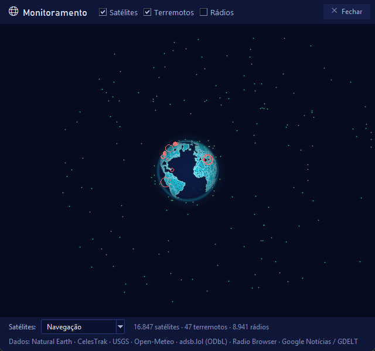
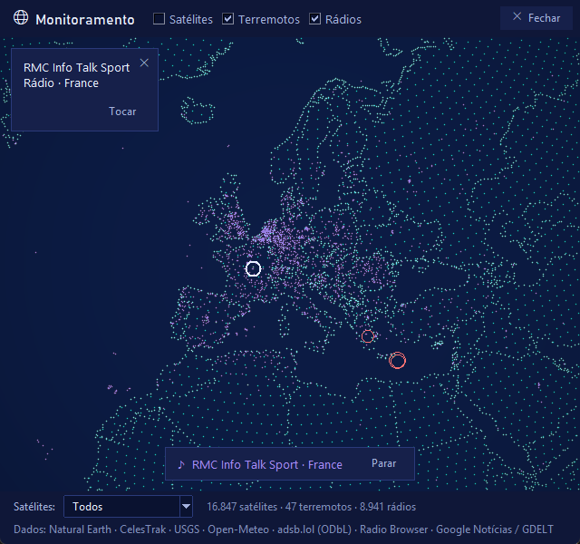

<h1 align="center">PI dreams</h1>

<p align="center"><b>Português</b> · <a href="README.en.md">English</a></p>

<p align="center"></p>

<p align="center">
  <b>Assistente pessoal de voz no estilo JARVIS, local e gratuito, para Windows.</b><br>
  Conversa em português do Brasil, enxerga pela câmera quando você pede e lembra do que você
  contou. A IA roda no seu computador: sua voz, sua imagem e suas conversas não vão para a nuvem.
</p>

<p align="center">
  
  
  <a href="LICENSE"></a>
</p>

<p align="center">
  <a href="../../releases/latest"></a>
</p>

## O que ele faz

- **Conversa por voz e por texto**, em português, com interrupção falando por cima.
- **Quatro [aparências](#aparências)**, escolhidas em Configurações → Geral e trocadas na hora: o
  rosto 3D em holograma, que segue o cursor com o olhar e mexe a boca com a fala, um núcleo de
  energia (estilo JARVIS), um cérebro digital 3D em holograma ou uma orbe. Todas mostram se ele está
  ouvindo, pensando ou falando e reagem ao volume da voz, sem usar a placa de vídeo.
- **Janela que se adapta** do notebook ao monitor ultrawide: a aparência cresce com o espaço,
  a frase falada aparece como legenda e, em telas largas, cartões mostram o clima, a agenda de
  hoje, os lembretes e os e-mails não lidos.
- **Câmera**: "tá me vendo?", "o que eu tô segurando?" — mostra o vídeo numa janela e só
  abre a câmera quando você liga.
- **[Memória de longo prazo](#memória-e-base-de-documentos)**: lembra o que você conta (nome,
  preferências, trabalho, família) e usa isso em qualquer pedido, entende respostas curtas como
  "sim, desde 2019" e esquece o que deixou de valer ("vendi o carro").
- **[Base de documentos](#memória-e-base-de-documentos)**: guarde PDF, Word, planilhas, slides e
  textos; ele responde com base neles, achando por significado ou pela palavra exata (códigos,
  números de pedido), e diz de qual arquivo e página veio.
- **[Mapa da memória](#mapa-da-memória)**: embaixo do assistente, tudo o que ele guardou aparece
  como um grafo agrupado por assunto (família, trabalho, lazer...), com os documentos da Base; o
  que ele usou na última resposta fica destacado, para entender por que respondeu daquele jeito.
- **[Pesquisa profunda](#pesquisa-profunda)**: tira dúvidas sobre o tema com perguntas de
  múltipla escolha, pesquisa na Wikipédia e nas notícias, lê as fontes e escreve um relatório com
  citações, que fica guardado na Base.
- **[Monitoramento](#monitoramento)**: um globo 3D que gira com o mouse, com os mais de 16 mil
  satélites em órbita em tempo real, terremotos do dia e rádios do mundo. Clique num país ou
  pergunte ("o que está acontecendo no Japão?") e um agente próprio resume as notícias de lá
  citando os veículos, além de clima, voos e rádio ao vivo. Usa internet, com fontes gratuitas; o
  resto do PI continua local.
- **Ferramentas**: abre aplicativos, pesquisa na web, lê páginas e usa a área de
  transferência.
- **Controle do PC**: volume, mudo e música (pausar, próxima, anterior), janelas abertas
  (listar, trazer para frente, minimizar, maximizar, fechar), brilho da tela, bloquear, desligar e
  reiniciar. Fechar, bloquear, desligar e reiniciar só acontecem depois do seu "sim".
- **Três personalidades**: JARVIS espirituoso, amigável e direto, ou formal.
- **Resumo ao abrir**: uma vez por dia, ao abrir, diz a data, o clima, os compromissos de hoje,
  os e-mails não lidos e os lembretes (Configurações → Geral escolhe as partes).
- **Lembretes**: "me lembra de pagar a conta na sexta", "quais lembretes eu tenho?", "já paguei".
  Avisa ao abrir o PI no dia e, se ele estiver aberto, na hora marcada.
- **Conexões** (aba SERV → CONEXÕES), cada uma desligada até você ligar:
  - **Arquivos**: procura, lê, move e renomeia arquivos — só nas pastas que você liberar.
  - **Navegador**: abre sites, lê a página, clica e preenche, num Edge separado do seu (sem as
    suas contas).
  - **Gmail**: procura, lê e resume e-mails, cria rascunhos e envia. Usa uma
    [senha de app](https://myaccount.google.com/apppasswords) do Google, não a sua senha.
  - **Agenda do Google**: "o que eu tenho amanhã?", "quando é o dentista?" — só leitura, pelo
    "endereço secreto no formato iCal" da sua agenda.
  - **Qualquer servidor [MCP](https://modelcontextprotocol.io/)** local, em "+ ADICIONAR CONEXÃO".

  Tudo que **altera** algo (mover arquivo, enviar e-mail, clicar num botão de site) só acontece
  depois do seu "sim", por voz ou no botão CONFIRMAR. Na primeira vez que liga Arquivos ou
  Navegador, o app baixa o Node (~35 MB), que roda esses dois.

## Aparências

Todas desenhadas pelo próprio app, sem placa de vídeo e sem arte de terceiros, e trocadas na hora
em Configurações → Geral. Cada uma mostra os mesmos estados: ociosa, ouvindo, pensando e falando
(no ritmo e no volume da voz).

| Aparência | Como é |
|---|---|
| **Rosto** | Holograma 3D de pontos e linhas, feito sobre a geometria aberta de rosto do MediaPipe (Apache-2.0). Vira a cabeça e os olhos para o cursor do mouse, pisca e mexe a boca e o queixo a cada sílaba da fala |
| **Núcleo de energia** | Anel de energia azul com arcos girando, no estilo JARVIS, que pulsa com a voz |
| **Cérebro digital** | Holograma 3D com dois hemisférios, sulcos, cerebelo e tronco cerebral, gerado por código, que balança devagar sozinho. Pensando, pulsos de luz correm pelas conexões; falando, ondas de luz saem do centro com a voz |
| **Orbe** | Esfera de luz minimalista com uma onda em volta que segue o volume real da voz |

<table>
  <tr>
    <td align="center"><br><b>Rosto</b></td>
    <td align="center"><br><b>Núcleo de energia</b></td>
    <td align="center"><br><b>Cérebro digital</b></td>
    <td align="center"><br><b>Orbe</b></td>
  </tr>
</table>

## Memória e Base de documentos

O PI tem duas memórias, as duas guardadas só no seu PC:

**Memória de longo prazo — o que você contou.** A cada 4 mensagens, ou na hora quando você conta
algo sobre si ("eu trabalho com...", "me mudei para..."), ele relê a conversa recente e anota os
fatos novos em frases curtas. Seu nome, como quer ser chamado e como prefere que ele responda
ficam no **perfil**, que está sempre presente; o resto vira **fatos**, que ele busca por significado a cada pergunta (os 3 mais
parecidos). Antes de guardar, compara com as memórias parecidas e decide se o fato é novo, se já
sabia, se substitui um antigo ("agora trabalho em outro lugar") ou se apaga um que deixou de valer
("vendi o carro"); na dúvida, guarda em vez de apagar. A lista completa fica na aba **Memória**,
onde dá para apagar uma por uma ou tudo; o botão **Como funciona** dessa aba mostra
este fluxo desenhado, do que é guardado ao que é lembrado.

<p align="center"><br><sub>A janela <b>Como funciona</b> da aba Memória.</sub></p>

**Base de documentos — o que você entregou.** Na aba **Base**, escolha arquivos (PDF, Word,
PowerPoint, Excel, CSV, TXT, Markdown) ou cole um texto com título. Cada arquivo é dividido em
trechos que lembram de onde vieram (página do PDF, slide, aba da planilha). A cada pergunta, ele
busca os trechos de duas formas ao mesmo tempo, por **significado** ("multa por atraso" acha
"penalidade por mora") e pela **palavra exata** (separa o contrato "2024-0815" do "2024-0816"), e
responde dizendo o arquivo e o lugar ("p. 3", "slide 5"). Os relatórios da Pesquisa profunda também
entram aqui. Na aba, cada documento abre para mostrar seus trechos.

Uma pergunta quase igual a outra feita no mesmo dia é respondida na hora, sem esperar o modelo.

## Mapa da memória

Embaixo da aparência, o **Mapa da memória** desenha tudo o que o PI sabe como um grafo:

<p align="center"><br><sub>Memórias e documentos fictícios.</sub></p>

- **Assuntos** (família, trabalho, saúde, rotina, lazer, animais, casa, finanças, estudos) no
  centro de cada grupo. O próprio modelo marca o assunto de cada memória, aos poucos e só quando
  está parado;
- **Perfil** em violeta, **fatos** em ciano, cada um ligado ao mais parecido do mesmo assunto;
- **Documentos** da Base em pêssego, com seus trechos ao abrir o documento;
- um **anel amarelo** em volta do que ele usou na última resposta — memórias e trechos —, para
  você ver por que ele respondeu daquele jeito.

Arraste para mover, use a roda para aproximar e clique num ponto para ler o texto inteiro ou
apagar aquela memória. O botão **Minimizar** recolhe o mapa, que não gasta nada enquanto está
escondido.

## Monitoramento

<p align="center"></p>

O botão **Monitoramento** (ou "abra o monitoramento", por voz) troca a aparência por um globo da
Terra desenhado em pontos e linhas, que gira com o mouse e aproxima com a roda. Em volta dele, os
**mais de 16 mil satélites ativos** se movem em tempo real, cada um na sua altitude, com a Estação
Espacial em destaque. Os terremotos do dia aparecem como círculos do tamanho da magnitude e as
rádios do mundo, como pontos violeta.

Enquanto o Monitoramento está aberto, um **agente próprio** assume a conversa, só com funções de
monitoramento. Ao clicar num país ou perguntar sobre um lugar, o globo gira até lá e ele responde:

<table>
  <tr>
    <td align="center"><br><b>Terremotos do dia</b><br>clique para ver local, magnitude e hora</td>
    <td align="center"><br><b>Filtro de satélites</b><br>aqui, só os de navegação (GPS, Galileo, GLONASS)</td>
    <td align="center"><br><b>Rádios ao vivo</b><br>tocam dentro do PI e pausam quando ele fala</td>
  </tr>
</table>

| Pergunte | Ele faz |
|---|---|
| "O que está acontecendo no Japão?" | Gira até o Japão e resume as notícias do dia, dizendo de quais veículos vieram |
| "Como está o tempo em Lisboa?" | Clima de agora e dos próximos 3 dias |
| "Teve algum terremoto hoje?" | Os mais fortes das últimas 24 h, no mundo ou perto de um lugar |
| "Quantos aviões estão voando sobre São Paulo?" | Aeronaves num raio de ~250 km, com altitude |
| "Toca uma rádio da França" | Toca a rádio mais ouvida da região que estiver no ar |
| "Onde está a Estação Espacial?" | Gira até ela e diz a altitude e sobre onde está passando |
| "Fechar monitoramento" | Volta ao PI normal na hora |

| Dado | Fonte (gratuita, sem conta) |
|---|---|
| Notícias | Google Notícias; GDELT como reserva |
| Clima e nomes de lugares | [Open-Meteo](https://open-meteo.com) |
| Terremotos | [USGS](https://earthquake.usgs.gov) |
| Voos | [adsb.lol](https://adsb.lol) (dados abertos, ODbL) |
| Satélites | Órbitas da [CelesTrak](https://celestrak.org); a posição é calculada no seu PC |
| Rádios | [Radio Browser](https://www.radio-browser.info) (rádios em MP3) |
| Contornos dos países | [Natural Earth](https://www.naturalearthdata.com) (domínio público) |

O Monitoramento usa a internet só enquanto está aberto. As órbitas ficam guardadas no PC, então os
satélites continuam aparecendo sem conexão. Não há câmeras.

## Pesquisa profunda

O botão **Pesquisa profunda** (ou "abra a pesquisa profunda", por voz) abre um modo em que um agente
próprio pesquisa um tema a fundo. Peça, por exemplo, "pesquisa a fundo sobre baterias de sódio":

1. se o tema for vago, faz antes 1 a 3 perguntas de múltipla escolha (foco, sentido, profundidade),
   que você responde clicando, por voz ("a segunda") ou pula;
2. divide o tema em 3 a 5 perguntas;
3. busca na Wikipédia (português e inglês) e nas notícias;
4. lê até 12 fontes e anota, de cada uma, só o que responde às perguntas;
5. escreve um relatório com seções, conclusão e citações numeradas [1], [2]… das fontes que leu;
6. fala um resumo e guarda o relatório na **Base**, com o tema e a data no nome.

Leva de 1 a 3 minutos e avisa o andamento; a conversa continua livre enquanto isso. Diga "cancelar
pesquisa" para parar. Depois, no PI normal, pergunte sobre o relatório ("o que a pesquisa das baterias
dizia sobre custo?") e ele responde citando-o. Toda fonte listada foi de fato lida; quando as fontes
não bastam, ele diz isso em vez de completar por conta própria. Sem conta: só fontes gratuitas, então
temas bem específicos podem render menos fontes.

## Experimente dizer

| Você diz | O que acontece |
|---|---|
| "Tá me vendo? O que eu tô segurando?" | Liga a câmera e descreve a imagem |
| "Meu cachorro se chama Biscoito" | Guarda na memória e usa nas próximas conversas |
| "O que o contrato diz sobre multa?" | Responde pela Base, dizendo o arquivo e a página |
| "Pesquisa a fundo sobre baterias de sódio" | Abre a Pesquisa profunda e escreve o relatório |
| "Abre o monitoramento" | Troca a aparência pelo globo com satélites, terremotos e rádios |
| "Me lembra de pagar a conta na sexta" | Cria o lembrete e avisa no dia |
| "O que eu tenho amanhã?" | Lê os compromissos da sua agenda |
| "Tenho e-mail novo do banco?" | Procura no Gmail e resume |
| "Procura o contrato na pasta Documentos" | Encontra e lê o arquivo nas pastas liberadas |
| "Abre a calculadora" / "Pesquisa a previsão do tempo" | Abre o programa ou a pesquisa no navegador |
| "Copia esse resumo" | Coloca o texto na área de transferência |
| "Abaixa o volume" / "Pausa a música" | Muda o volume ou controla o que está tocando |
| "Traz o Chrome pra frente" / "Fecha o Bloco de Notas" | Mexe nas janelas abertas (fechar pede confirmação) |
| "Desliga o PC daqui a 10 minutos" | Agenda o desligamento, com confirmação e cancelável por voz |

## Privacidade: o que fica e o que sai do seu PC

| Fica no seu PC | Usa a internet, só quando você pede ou liga |
|---|---|
| Sua voz (o áudio nem é gravado em disco) | Clima ([Open-Meteo](https://open-meteo.com)) |
| As conversas e a IA que responde | Pesquisa na web e leitura de páginas |
| A imagem da câmera | Gmail e Agenda do Google, se você conectar |
| Memória, base de documentos e lembretes | Navegador, nos sites que você pedir |
| Suas preferências e senhas (cifradas) | Downloads de modelos e do Node, uma vez |
| Os relatórios da Pesquisa profunda (na Base) | Pesquisa profunda, quando você pede: o tema vai para a Wikipédia, o Google Notícias e, se disponível, o DuckDuckGo |
| O globo e o cálculo da posição dos satélites | Monitoramento, quando aberto: os lugares que você pergunta ou clica vão para as fontes de notícias, clima e voos; órbitas, terremotos e a lista de rádios são baixados; a rádio tocando conecta direto na emissora |

O PI dreams não tem conta, não tem assinatura e não envia telemetria.

## Requisitos

| Item | Mínimo |
|---|---|
| Sistema | Windows 10 ou 11, 64 bits |
| Memória RAM | 16 GB |
| Espaço livre | 15 GB |
| Placa de vídeo | Opcional. Com NVIDIA, Intel Arc ou AMD as respostas ficam bem mais rápidas |
| Internet | Na instalação, para baixar os modelos. Depois, a conversa funciona offline |

## Instalação

1. Baixe o `PIDreams-Setup-<versão>.exe` na
   [última versão](../../releases/latest).
2. Abra o arquivo. Como o instalador ainda não tem assinatura digital, o Windows mostra um
   aviso:
   - **"O Windows protegeu o computador"** (SmartScreen): clique em **Mais informações** e
     depois em **Executar assim mesmo**.
   - **"Abrir Arquivo - Aviso de Segurança"**: clique em **Executar**.
3. Siga o instalador. Ele confere os requisitos, instala o
   [Ollama](https://ollama.com) (o programa que roda os modelos de IA) se você ainda não
   tiver, e baixa os modelos — isso pode levar alguns minutos.
4. Na primeira abertura, um assistente pergunta como o PI dreams deve chamar você, qual
   personalidade prefere, qual microfone e saída de som usar, sua cidade (para o clima) e a
   voz.

Não é preciso privilégio de administrador.

## Onde ficam seus dados

Tudo o que é seu fica em `%LOCALAPPDATA%\PIDreams`, separado do programa:

| Pasta/arquivo | Conteúdo |
|---|---|
| `settings.json` | Suas preferências |
| `secrets.bin` | Chaves de integrações, cifradas pelo Windows (só o seu usuário lê) |
| `data\qdrant` | Memória e base de documentos |
| `models` | Modelos de IA baixados |
| `logs\pi_dreams.log` | Registro de funcionamento, útil para relatar problemas |

O áudio do microfone é processado só na memória e nunca é gravado em disco.

Ao desinstalar, o instalador pergunta se deve apagar essa pasta (o padrão é manter).

## Modelos de IA

Os modelos são baixados durante a instalação, cada um sob a licença do seu autor. O de conversa
(via Ollama) é escolhido pelo seu hardware e pode ser trocado nas configurações:

| Seu PC | Modelo de conversa |
|---|---|
| Sem placa de vídeo dedicada ou com menos de 6 GB | Qwen3 4B Instruct |
| Placa de vídeo com 6 a 12 GB | Qwen3 8B |
| Placa de vídeo com 12 GB ou mais | Qwen 2.5 14B |

Além dele: o Whisper (reconhecimento de voz), o `multilingual-e5-large` (memória e Base) e, ao
ligar a câmera pela primeira vez, o Qwen3-VL 2B (visão). Todos os modelos de conversa e de visão são Apache-2.0. A voz em português vem da coleção
[Piper](https://github.com/rhasspy/piper).

## Para desenvolvedores

Requer o [Python 3.12 do python.org](https://www.python.org/downloads/) (não o da
Microsoft Store: a sandbox dele bloqueia a câmera) e o [Ollama](https://ollama.com).

```powershell
python -m venv .venv-dev
.venv-dev\Scripts\pip install -r requirements\build.txt
.venv-dev\Scripts\python -m pidreams          # abre o app
```

- **Estrutura**: `pidreams/core` (caminhos, configurações, log, segredos), `agent` (conversa,
  ferramentas, personas, avisos de problema), `audio`, `stt`, `memory` (memória, Base, mapa),
  `research` (Pesquisa profunda), `monitor` (Monitoramento), `mcp` (conexões), `pc` (controle do
  PC), `camera`, `hardware` (GPU, Ollama, modelos) e `ui` (janelas, painéis e aparências); o
  instalador fica em `installer`.
- **Build do instalador**: `powershell -ExecutionPolicy Bypass -File installer\build.ps1`
  (precisa do [Inno Setup 6](https://jrsoftware.org/isinfo.php)).

## Construído com

O PI dreams só existe graças a estes projetos abertos:
[Ollama](https://ollama.com) e os modelos [Qwen](https://github.com/QwenLM) (conversa e visão),
[faster-whisper](https://github.com/SYSTRAN/faster-whisper) (reconhecimento de voz),
[Piper](https://github.com/rhasspy/piper) (voz),
[Qdrant](https://qdrant.tech) e [FastEmbed](https://github.com/qdrant/fastembed) (memória),
[pypdf](https://github.com/py-pdf/pypdf) (leitura de PDF),
[sgp4](https://github.com/brandon-rhodes/python-sgp4) e [miniaudio](https://github.com/irmen/pyminiaudio) (Monitoramento),
[Model Context Protocol](https://modelcontextprotocol.io/) (conexões),
[OpenCV](https://opencv.org) (câmera) e
[LangChain Text Splitters](https://github.com/langchain-ai/langchain) (divisão dos documentos).

Dados do Monitoramento, consultados só em uso: [Natural Earth](https://www.naturalearthdata.com) (contornos, domínio público), [CelesTrak](https://celestrak.org), [USGS](https://earthquake.usgs.gov), [Open-Meteo](https://open-meteo.com), [adsb.lol](https://adsb.lol) (ODbL), [Radio Browser](https://www.radio-browser.info), Google Notícias e [GDELT](https://www.gdeltproject.org).

## Licença

O código do PI dreams é [MIT](LICENSE). O instalador para Windows embute o Piper (síntese de
voz, GPL-3.0), por isso é distribuído sob a [GPL-3.0](LICENSES/GPL-3.0.txt). Detalhes de cada
componente em [THIRD_PARTY_NOTICES.md](THIRD_PARTY_NOTICES.md).
